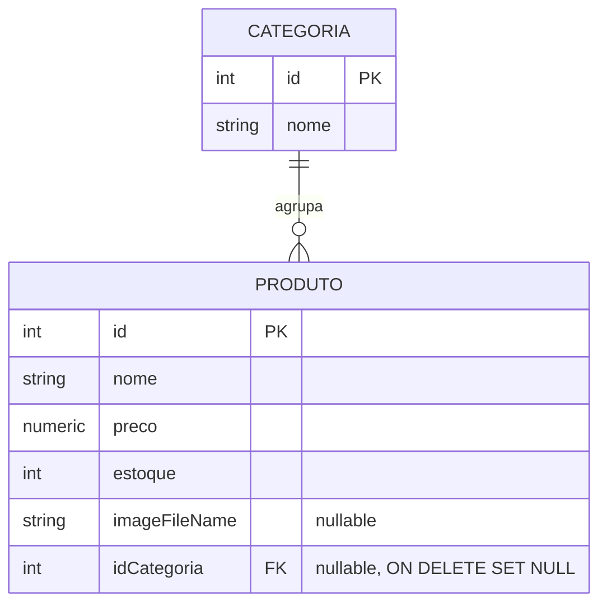
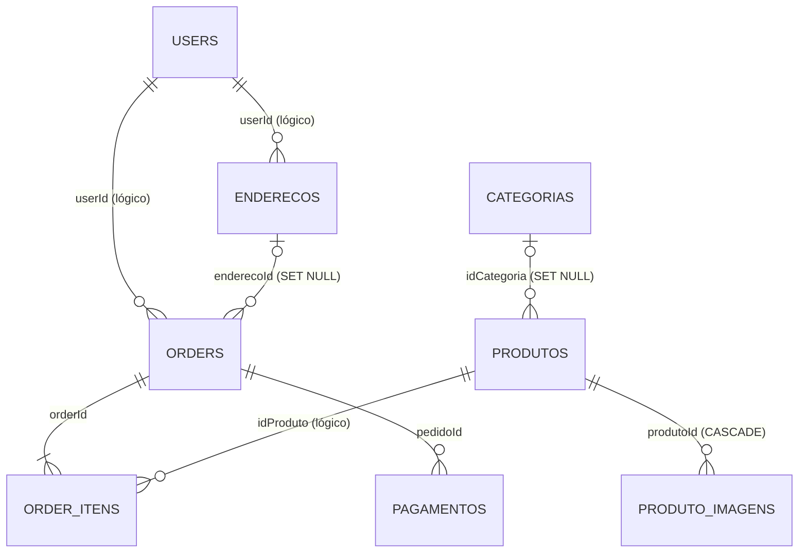
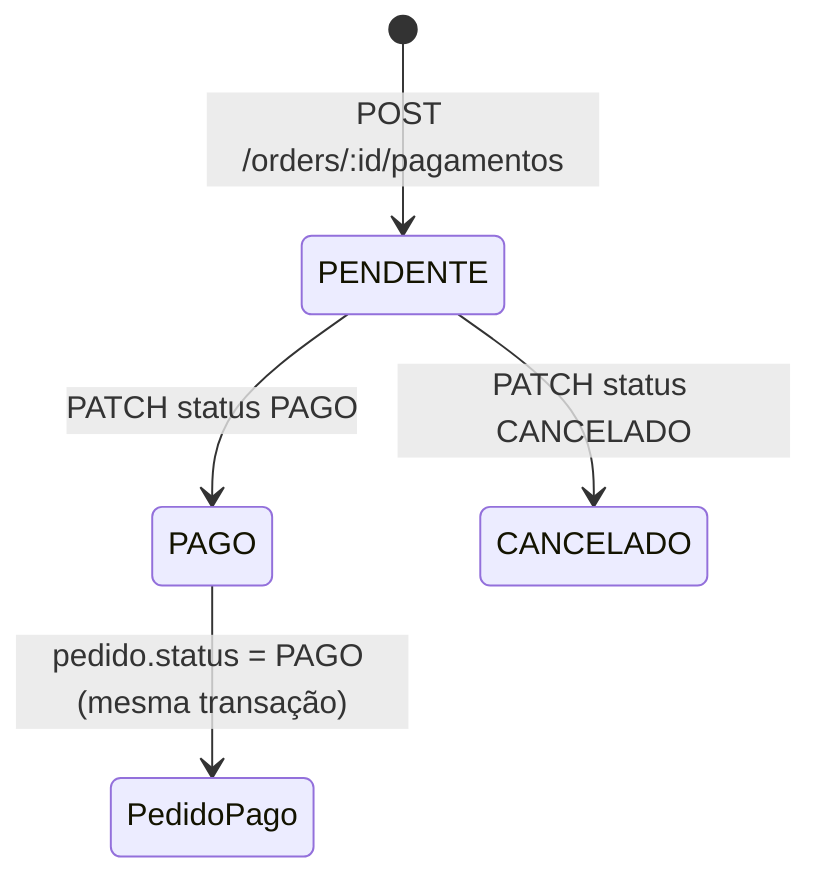

# loja-api

API de uma loja virtual feita em **NestJS + TypeORM + PostgreSQL**, seguindo a trilha da disciplina de Programação Web 3 do Instituto Federal de Educação Ciência e Tecnologia - Campus Jaboatão dos Guararapes (linha **P**, caps. 1 a 10) e ampliada com a **linha A**: pacotes **Endereço**, **Pagamento (fake)** e **Categorias**, mais as features A dos capítulos.

> **Nomes em português:** o projeto usa rotas e campos em português (`/produtos`, `nome`, `acesso_token`, `CLIENTE`...). A [tabela de equivalência](#tabela-de-equivalência-contrato--este-projeto) mostra o nome do contrato e o nome usado aqui.

## Sumário

- [Tecnologias e versões](#tecnologias-e-versões)
- [Como rodar](#como-rodar)
- [Usuários do seed](#usuários-do-seed)
- [Swagger](#swagger)
- [Rotas](#rotas)
- [Matriz de papéis](#matriz-de-papéis)
- [Política de erro](#política-de-erro)
- [Regras de negócio e decisões](#regras-de-negócio-e-decisões)
- [Diagramas](#diagramas)
- [Tabela de equivalência (contrato → este projeto)](#tabela-de-equivalência-contrato--este-projeto)
- [Curls — linha P](#curls--linha-p)
- [Curls — linha A](#curls--linha-a)
- [Uso de IA](#uso-de-ia)

---

## Tecnologias e versões

| Item | Versão |
|---|---|
| Node.js | 24 |
| NestJS | 12 |
| TypeORM | 1.1 |
| PostgreSQL (Docker) | 16-alpine |
| Autenticação | JWT (`@nestjs/jwt` + `passport-jwt`), senhas com `bcryptjs` |
| Documentação | `@nestjs/swagger` em `/api` |

---

## Como rodar

### 1. Pré-requisitos
- Node.js 24 e npm
- Docker Desktop (aberto)
- Git Bash (os curls deste README são **Bash**; não cole no PowerShell)

### 2. Variáveis de ambiente (`.env`)
O `.env` não vai para o Git. Copie o modelo e troque os segredos:

```bash
cp .env.example .env
```

| Variável | Exemplo | Para quê |
|---|---|---|
| `DB_HOST` | `localhost` | host do Postgres |
| `DB_PORT` | `3005` | porta exposta pelo Docker (3005 → 5432) |
| `DB_USERNAME` / `DB_PASSWORD` / `DB_DATABASE` | `loja` / `loja` / `loja` | acesso ao banco |
| `JWT_SECRET` | texto longo | assina o **acesso_token** |
| `JWT_EXPIRES_IN` | `1h` | validade do acesso_token |
| `JWT_REFRESH_SECRET` | outro texto longo (**diferente** do anterior) | assina o **refresh_token** |
| `JWT_REFRESH_EXPIRES_IN` | `1d` | validade do refresh_token |

### 3. Subir o Postgres (e o pgAdmin)

```bash
docker compose up -d
```

- Postgres: container `loja-postgres`, porta **3005**, usuário/senha/banco `loja`.
- pgAdmin: http://localhost:5050 (login `admin@loja.com` / `admin`).

### 4. Instalar e subir a API

```bash
npm install
npm run start:dev
```

A API sobe em http://localhost:3000. Com `synchronize: true`, o TypeORM cria/atualiza as tabelas na primeira subida.

### 5. Rodar o seed

Com a API já tendo subido **pelo menos uma vez** (para as tabelas existirem), a partir da pasta `loja-api/`:

```bash
docker exec -i loja-postgres psql -U loja -d loja -v ON_ERROR_STOP=1 < seed/seed.sql
bash seed/verify-seed.sh   # opcional: confere se o hash do seed é "secret123"
```

> ⚠️ O `seed.sql` **apaga todos os dados** (usuários, pedidos, endereços, pagamentos, produtos, galeria, categorias) e reinicia os ids em 1.
> Ele roda dentro de uma transação: com `ON_ERROR_STOP=1`, qualquer erro cancela tudo e o banco fica como estava.

O seed adapta o seed oficial da trilha para os nomes deste projeto (`produtos`, `order_itens`, coluna `perfil`) e acrescenta o usuário **MANAGER** e duas categorias.

`seed/seed-catalog.sql` é o seed parcial do cap. 5 (só produtos).

---

## Usuários do seed

| Papel | `perfil` | Login | Senha |
|---|---|---|---|
| Administrador | `ADMIN` | `ana` | `secret123` |
| Cliente | `CLIENTE` | `cli` | `secret123` |
| Gerente | `MANAGER` | `mgr` | `secret123` |
| Visitante | — | sem token | — |

Novos usuários criados por `POST /auth/registro` nascem como `CLIENTE`.

Dados criados pelo seed: produtos `1 Caneca Nest` (categoria 1) e `2 Camiseta ADS` (categoria 2); categorias `1 Canecas` e `2 Camisetas`.

---

## Swagger

http://localhost:3000/api

1. Faça login em `POST /auth/login` e copie o `acesso_token`.
2. Clique em **Authorize** e cole o token (sem a palavra `Bearer`).
3. Rotas com cadeado exigem token. Cada rota lista as respostas que realmente devolve (200/201/204, 400, 401, 403, 404).

---

## Rotas

### Linha P

| Método | Rota | Auth |
|---|---|---|
| GET | `/health` | público |
| GET | `/produtos`, `/produtos/:id` | público |
| POST | `/produtos` | ADMIN |
| PUT | `/produtos/:id` | ADMIN ou MANAGER |
| DELETE | `/produtos/:id` | ADMIN |
| POST | `/produtos/:id/image` (campo `file`, jpeg/png/webp, até 2 MB) | ADMIN |
| GET | `/produtos/:id/image` | público |
| POST | `/auth/registro`, `/auth/login` | público |
| POST | `/orders` | JWT |
| GET | `/orders`, `/orders/:id` | JWT (CLIENTE só os seus) |
| POST | `/orders/:id/cancel` | JWT (dono ou ADMIN) |

### Linha A — features dos capítulos

| Cap. | Método | Rota | Auth |
|---|---|---|---|
| 1 | GET | `/health/version` | público |
| 2 | GET | `/produtos?q=&minPrice=&maxPrice=` | público |
| 2 / 2.1 | PATCH | `/produtos/:id` (`PatchProdutoDto` = `PartialType(CreateProdutoDto)`) | ADMIN ou MANAGER |
| 3 | GET | `/catalogo/summary` | público |
| 5.1 | PATCH | `/orders/:id/status` | JWT (`CANCELADO`: dono ou ADMIN; `PAGO`: só ADMIN) |
| 6 | GET | `/auth/me` | JWT |
| 6 | POST | `/auth/refresh` | refresh_token no body |
| 7 | — | papel `MANAGER` (ver [matriz](#matriz-de-papéis)) | — |
| 9 | POST | `/produtos/:id/images` (campo `files`, até 5 imagens jpeg/png de até 2 MB) | ADMIN |
| 9 | GET | `/produtos/:id/images` | público |
| 9 | DELETE | `/produtos/:id/images/:imageId` | ADMIN |

### Linha A — pacote Endereço

| Método | Rota | Auth |
|---|---|---|
| POST | `/enderecos` | JWT |
| GET | `/enderecos` | JWT (só os do usuário) |
| PUT | `/enderecos/:id` | JWT (dono) |
| DELETE | `/enderecos/:id` | JWT (dono) |
| PATCH | `/orders/:id/endereco` + `{ "enderecoId" }` | JWT (pedido e endereço do próprio usuário) |

### Linha A — pacote Pagamento (fake)

| Método | Rota | Auth |
|---|---|---|
| POST | `/orders/:id/pagamentos` + `{ "metodo" }` | JWT (dono do pedido) |
| GET | `/pagamentos?status=&pedidoId=` | JWT (ADMIN vê todos; demais, só os seus) |
| PATCH | `/pagamentos/:id/status` + `{ "status" }` | JWT (dono ou ADMIN) |
| DELETE | `/pagamentos/:id` | ADMIN |

### Linha A — pacote Categorias

| Método | Rota | Auth |
|---|---|---|
| GET | `/categorias`, `/categorias/:id` | público |
| GET | `/categorias/:id/produtos` | público |
| POST | `/categorias` | ADMIN |
| PATCH | `/categorias/:id` | ADMIN |
| DELETE | `/categorias/:id` | ADMIN |
| PATCH | `/produtos/:id/categoria` + `{ "idCategoria" }` | ADMIN |

---

## Matriz de papéis

| Ação | Visitante | CLIENTE | MANAGER | ADMIN |
|---|---|---|---|---|
| Ver produtos, categorias, catálogo | ✅ | ✅ | ✅ | ✅ |
| Criar / apagar produto | 401 | 403 | **403** | ✅ |
| Editar produto (PUT/PATCH) | 401 | 403 | ✅ | ✅ |
| Criar / editar / apagar categoria, associar produto | 401 | 403 | 403 | ✅ |
| Criar pedido | 401 | ✅ | ✅ | ✅ |
| Listar pedidos | 401 | só os seus | **todos** | todos |
| Cancelar / mudar status de pedido de outro | 401 | 404 | **403** | ✅ |
| Marcar pedido como PAGO por `PATCH /orders/:id/status` | 401 | **403** | **403** | ✅ |
| Endereços | 401 | só os seus | só os seus | só os seus |
| Ligar endereço / pagar pedido de outro | 401 | 404 | 403 | 403 |
| Listar pagamentos | 401 | só os seus | só os seus | **todos** |
| Marcar pagamento PAGO / CANCELADO | 401 | só os seus | só os seus | todos |
| Apagar pagamento | 401 | 403 | 403 | ✅ |

---

## Política de erro

| Situação | Status | Onde a regra fica |
|---|---|---|
| Sem token, token inválido ou expirado | **401** | `JwtAuthGuard` |
| Papel insuficiente (ex.: CLIENTE criando produto, MANAGER apagando produto) | **403** | `RolesGuard` + `@Roles(...)` |
| **Recurso de outro usuário** (pedido, endereço, pagamento) | **404** | service (`findOneForUser` / `findOneForActor`) |
| Dados inválidos, campo extra no body, id não numérico | **400** | `ValidationPipe` (`whitelist` + `forbidNonWhitelisted`) e `ParseIntPipe` |
| Regra de domínio violada (estoque insuficiente, pedido não ABERTO, pagamento ativo duplicado...) | **400** | service |

**Escolha: 404 para recurso de outro usuário, em todo o projeto.** O 404 não revela que o recurso existe. Quem tenta `/enderecos/1`, `/2`, `/3`... não consegue descobrir quais ids existem. No código, "não existe" e "é de outro" passam pela **mesma** consulta (`where: { id, userId }`) e geram a mesma resposta.

**Quando aparece 403 em recurso de outro:** só para ADMIN/MANAGER, que **enxergam** o pedido (para eles o recurso existe), mas não têm permissão para aquela ação. Exemplo: o MANAGER vê todos os pedidos, mas não cancela pedido alheio. Isso é papel insuficiente, não ocultação.

---

## Regras de negócio e decisões

### Pedidos (cap. 5.1)
- Criar pedido desconta o estoque dentro de uma transação. Se o estoque for insuficiente → **400** `Estoque insuficiente para o produto X. Quantidade em estoque: N`.
- Status: `ABERTO → PAGO` ou `ABERTO → CANCELADO`. **Pedido PAGO não pode ser cancelado** (400).
- **Quem marca PAGO:** o cliente quita pelo pacote Pagamento (`PATCH /pagamentos/:id/status`), que muda o pedido na mesma transação. Em `PATCH /orders/:id/status`, só o **ADMIN** pode usar `PAGO` (ajuste manual da loja); CLIENTE e MANAGER recebem **403**. Sem essa regra, o cliente marcaria o pedido como pago sem criar pagamento, e um pagamento `PENDENTE` ficaria preso.
- Cancelar devolve o estoque dos itens.
- MANAGER vê todos os pedidos, mas só ADMIN altera ou cancela pedido de outro usuário.

### Endereço
- O dono vem **sempre do token** (`req.user.usuarioId`), nunca do body. Mandar `userId` no body → 400.
- `PATCH /orders/:id/endereco` checa, nesta ordem: pedido de outro → 404; ADMIN/MANAGER que não é dono → 403; pedido não ABERTO → 400; endereço de outro → 404.
- Apagar um endereço ligado a um pedido **não** quebra o pedido: a FK usa `onDelete: 'SET NULL'` e o pedido fica com `enderecoId = null`.

### Pagamento (fake: sem gateway, só grava no Postgres)
- Métodos `CARTAO | BOLETO | PIX`. Status `PENDENTE → PAGO` ou `PENDENTE → CANCELADO` (PAGO e CANCELADO são finais).
- Só pedido **ABERTO** recebe pagamento.
- **No máximo um pagamento ativo por pedido**: ativo = `PENDENTE` ou `PAGO`. Um pagamento `CANCELADO` libera o pedido para um novo.
- Marcar **PAGO** muda o pedido para **PAGO** na **mesma transação**.
- O **método não muda** depois de criado: o DTO do PATCH só aceita `status`.
- `valor` = soma de `precoUnico × quantidade` dos itens do pedido.
- MANAGER **não** vê pagamentos de outros (o contrato dá isso só ao ADMIN).
- ADMIN pode apagar qualquer pagamento.

### Categorias
- Leitura pública; criar, editar, apagar e associar são **só ADMIN** (cliente com JWT → 403).
- Apagar categoria não apaga produtos (`onDelete: 'SET NULL'`).

### Galeria de imagens (cap. 9)
- Tabela própria `produto_imagens` (N imagens → 1 produto). É diferente do `imageFileName` da linha P, que guarda **uma** imagem só.
- `POST /produtos/:id/images` usa `FilesInterceptor('files', 5)`: **várias** imagens no campo `files`, no máximo **5** por envio.
- Validações feitas pelo multer **antes** de chegar no service:
  - tipo diferente de `image/jpeg` ou `image/png` → **400** e a requisição inteira é rejeitada (nenhuma imagem é salva);
  - arquivo maior que **2 MB** → **413** (Payload Too Large);
  - mais de 5 arquivos → **400**.
- No service: nenhum arquivo → **400**; produto inexistente → **404** (e os arquivos já gravados em `./uploads` são apagados).
- `DELETE /produtos/:id/images/:imageId` busca a imagem por **id + produtoId** na mesma consulta: imagem de outro produto → **404**. Remove o registro e o arquivo do disco → **204**.
- Apagar o produto apaga as linhas da galeria (`onDelete: 'CASCADE'`).

### Refresh token (cap. 6)
- O login devolve `acesso_token` (curto, `JWT_SECRET`) e `refresh_token` (longo, `JWT_REFRESH_SECRET`).
- `POST /auth/refresh` valida o refresh com o segredo próprio e devolve um novo `acesso_token`. Inválido/expirado → 401.
- Segredos diferentes: um acesso_token não funciona como refresh, e vice-versa.

---

## Diagramas

### Categoria ↔ Produto (cap. 4)



Uma categoria tem **N** produtos; um produto pertence a **0 ou 1** categoria (`@OneToMany` em `Categoria`, `@ManyToOne` + `@JoinColumn({ name: 'idCategoria' })` em `Produto`).

### Modelo completo



"(lógico)" = coluna com o id, sem chave estrangeira no banco. O dono vem sempre do token.

### Ciclo do pagamento



---

## Tabela de equivalência (contrato → este projeto)

| Contrato (CURLS-P / avaliação A) | Este projeto |
|---|---|
| `/products` | `/produtos` |
| `name`, `price`, `stock` | `nome`, `preco`, `estoque` |
| `GET /products?q=` | `GET /produtos?q=` (+ `minPrice`, `maxPrice`) |
| `PatchProductDto` / `CreateProductDto` | `PatchProdutoDto` / `CreateProdutoDto` |
| `/products/:id/image` | `/produtos/:id/image` (mesmo campo `file`) |
| `PATCH /products/:id/category` | `PATCH /produtos/:id/categoria` + `{ idCategoria }` |
| `/categories` | `/categorias` |
| `/catalog/summary` → `{ totalProducts, totalStockUnits }` | `/catalogo/summary` → `{ produtosTotaisCadastrados, unidadesTotaisEmEstoque }` |
| `access_token` | `acesso_token` (o `refresh_token` mantém o nome) |
| `GET /auth/me` → `{ userId, username, email, role }` | `GET /auth/me` → `{ usuarioId, username, email, perfil }` |
| coluna/claim `role` | `perfil` |
| `CLIENT` / `ADMIN` / `MANAGER` | `CLIENTE` / `ADMIN` / `MANAGER` |
| `/orders` + `{ items: [{ productId, quantity }] }` | `/orders` + `{ itens: [{ idProduto, quantidade }] }` |
| status do pedido `OPEN` / `PAID` / `CANCELLED` | `ABERTO` / `PAGO` / `CANCELADO` |
| `/addresses` | `/enderecos` |
| `PATCH /orders/:id/address` + `{ addressId }` | `PATCH /orders/:id/endereco` + `{ enderecoId }` |
| `POST /orders/:id/payments` | `POST /orders/:id/pagamentos` |
| `GET /payments?status=&orderId=` | `GET /pagamentos?status=&pedidoId=` |
| `PATCH /payments/:id/status` | `PATCH /pagamentos/:id/status` |
| `DELETE /payments/:id` | `DELETE /pagamentos/:id` |
| método `CARD` / `BOLETO` / `PIX` | `CARTAO` / `BOLETO` / `PIX` |
| status do pagamento `PENDING` / `PAID` / `CANCELLED` | `PENDENTE` / `PAGO` / `CANCELADO` |
| `POST /products/:id/images`, `DELETE /products/:id/images/:imageId` | `POST /produtos/:id/images` (campo `files`), `DELETE /produtos/:id/images/:imageId` |
| tabelas `products`, `order_items` | `produtos`, `order_itens` |

Sem mudança: `/health`, `/health/version`, `/auth/login`, `/auth/refresh`, `/orders`, `/orders/:id/cancel`, `/orders/:id/status`, porta 3000, Swagger em `/api`.

---

## Curls — linha P

Base `http://localhost:3000`, depois do seed. Shell: **Git Bash**.

```bash
B=http://localhost:3000

# 1) Health
curl -s $B/health

# 2) Produtos (públicos)
curl -s $B/produtos
curl -s $B/produtos/1

# 3) Login e tokens (o campo é acesso_token)
TOKEN_ANA=$(curl -s -X POST $B/auth/login -H 'Content-Type: application/json' \
  -d '{"username":"ana","password":"secret123"}' \
  | python -c "import sys,json; print(json.load(sys.stdin)['acesso_token'])")
TOKEN_CLI=$(curl -s -X POST $B/auth/login -H 'Content-Type: application/json' \
  -d '{"username":"cli","password":"secret123"}' \
  | python -c "import sys,json; print(json.load(sys.stdin)['acesso_token'])")

# 4) Sem token → 401
curl -s -o /dev/null -w '%{http_code}\n' -X POST $B/produtos \
  -H 'Content-Type: application/json' -d '{"nome":"XYZ","preco":1,"estoque":1}'

# 5) Ana (ADMIN) cria produto → 201
curl -s -X POST $B/produtos -H "Authorization: Bearer $TOKEN_ANA" \
  -H 'Content-Type: application/json' -d '{"nome":"Adesivo IFPE","preco":5.5,"estoque":100}'

# 6) Cli (CLIENTE) cria produto → 403
curl -s -o /dev/null -w '%{http_code}\n' -X POST $B/produtos -H "Authorization: Bearer $TOKEN_CLI" \
  -H 'Content-Type: application/json' -d '{"nome":"XYZ","preco":1,"estoque":1}'

# 7) Cli cria pedido → 201; consulta; cancela
curl -s -X POST $B/orders -H "Authorization: Bearer $TOKEN_CLI" \
  -H 'Content-Type: application/json' -d '{"itens":[{"idProduto":1,"quantidade":1}]}'
curl -s $B/orders/1 -H "Authorization: Bearer $TOKEN_CLI"
curl -s -X POST $B/orders/1/cancel -H "Authorization: Bearer $TOKEN_CLI"

# 8) Swagger: abrir http://localhost:3000/api e usar Authorize com o token da Ana

# 9) Upload de imagem (Ana) e download — use qualquer .jpg/.png em ./fixtures/
#    (o fixture do material da disciplina é fixtures/caneca.jpg)
curl -s -X POST $B/produtos/1/image -H "Authorization: Bearer $TOKEN_ANA" -F 'file=@./fixtures/caneca.jpg'
curl -s -o /tmp/p.jpg -w '%{http_code}\n' $B/produtos/1/image
```

---

## Curls — linha A

Continuação do bloco anterior (mesmas variáveis). Os ids assumem o banco recém-semeado.

```bash
TOKEN_MGR=$(curl -s -X POST $B/auth/login -H 'Content-Type: application/json' \
  -d '{"username":"mgr","password":"secret123"}' \
  | python -c "import sys,json; print(json.load(sys.stdin)['acesso_token'])")
J='Content-Type: application/json'
```

### Cap. 1 — versão
```bash
curl -s $B/health/version          # {"name":"loja-api","version":"0.1.0"}
```

### Cap. 2 / 2.1 — busca e PATCH
```bash
curl -s "$B/produtos?q=caneca"
curl -s "$B/produtos?minPrice=10&maxPrice=50"
curl -s -X PATCH $B/produtos/1 -H "Authorization: Bearer $TOKEN_ANA" -H "$J" -d '{"estoque":50}'   # só estoque muda
```

### Cap. 3 — resumo do catálogo
```bash
curl -s $B/catalogo/summary
```

### Cap. 5.1 — status do pedido e estoque
```bash
# pedido novo do cli (id 2 após o bloco P)
curl -s -X POST $B/orders -H "Authorization: Bearer $TOKEN_CLI" -H "$J" -d '{"itens":[{"idProduto":2,"quantidade":1}]}'
# cli (dono) tenta marcar PAGO na mão → 403 (o cliente paga pelo pacote Pagamento)
curl -s -o /dev/null -w '%{http_code}
' -X PATCH $B/orders/2/status -H "Authorization: Bearer $TOKEN_CLI" -H "$J" -d '{"status":"PAGO"}'
# ana (ADMIN) marca PAGO → 200
curl -s -X PATCH $B/orders/2/status -H "Authorization: Bearer $TOKEN_ANA" -H "$J" -d '{"status":"PAGO"}'
# cli tenta cancelar o pedido já PAGO → 400
curl -s -X PATCH $B/orders/2/status -H "Authorization: Bearer $TOKEN_CLI" -H "$J" -d '{"status":"CANCELADO"}'
# estoque insuficiente → 400 com mensagem de domínio
curl -s -X POST $B/orders -H "Authorization: Bearer $TOKEN_CLI" -H "$J" -d '{"itens":[{"idProduto":1,"quantidade":9999}]}'
```

### Cap. 6 — /auth/me e refresh
```bash
curl -s $B/auth/me -H "Authorization: Bearer $TOKEN_CLI"
REFRESH=$(curl -s -X POST $B/auth/login -H "$J" -d '{"username":"cli","password":"secret123"}' \
  | python -c "import sys,json; print(json.load(sys.stdin)['refresh_token'])")
curl -s -X POST $B/auth/refresh -H "$J" -d "{\"refresh_token\":\"$REFRESH\"}"          # novo acesso_token
curl -s -o /dev/null -w '%{http_code}\n' -X POST $B/auth/refresh -H "$J" -d '{"refresh_token":"invalido"}'   # 401
```

### Cap. 7 — MANAGER
```bash
curl -s -o /dev/null -w '%{http_code}\n' -X PUT $B/produtos/1 -H "Authorization: Bearer $TOKEN_MGR" \
  -H "$J" -d '{"nome":"Caneca Nest","preco":42,"estoque":50}'      # 200
curl -s -o /dev/null -w '%{http_code}\n' -X DELETE $B/produtos/1 -H "Authorization: Bearer $TOKEN_MGR"   # 403
curl -s $B/orders -H "Authorization: Bearer $TOKEN_MGR"             # lista todos os pedidos
```

### Cap. 9 — Galeria de imagens
```bash
# ana envia 2 imagens de uma vez (campo "files" repetido) → 201 com a lista criada
curl -s -X POST $B/produtos/1/images -H "Authorization: Bearer $TOKEN_ANA"   -F 'files=@./fixtures/caneca.jpg' -F 'files=@./fixtures/caneca.jpg'
curl -s $B/produtos/1/images                                        # lista a galeria (público)
# tipo inválido → 400
echo x > /tmp/fake.txt
curl -s -X POST $B/produtos/1/images -H "Authorization: Bearer $TOKEN_ANA" -F 'files=@/tmp/fake.txt'
# cli (CLIENTE) → 403
curl -s -o /dev/null -w '%{http_code}
' -X POST $B/produtos/1/images -H "Authorization: Bearer $TOKEN_CLI"   -F 'files=@./fixtures/caneca.jpg'
# remove a imagem 1 do produto 1 → 204; de novo → 404; imagem 2 pelo produto errado → 404
curl -s -o /dev/null -w '%{http_code}
' -X DELETE $B/produtos/1/images/1 -H "Authorization: Bearer $TOKEN_ANA"
curl -s -o /dev/null -w '%{http_code}
' -X DELETE $B/produtos/1/images/1 -H "Authorization: Bearer $TOKEN_ANA"
curl -s -o /dev/null -w '%{http_code}
' -X DELETE $B/produtos/2/images/2 -H "Authorization: Bearer $TOKEN_ANA"
```

### Pacote Categorias
```bash
curl -s $B/categorias
curl -s $B/categorias/1/produtos
curl -s -X POST $B/categorias -H "Authorization: Bearer $TOKEN_ANA" -H "$J" -d '{"nome":"Adesivos"}'      # 201
curl -s -X PATCH $B/categorias/3 -H "Authorization: Bearer $TOKEN_ANA" -H "$J" -d '{"nome":"Adesivos IFPE"}'
curl -s -X PATCH $B/produtos/3/categoria -H "Authorization: Bearer $TOKEN_ANA" -H "$J" -d '{"idCategoria":3}'
curl -s -o /dev/null -w '%{http_code}\n' -X POST $B/categorias -H "Authorization: Bearer $TOKEN_CLI" \
  -H "$J" -d '{"nome":"Hack"}'                                      # 403
curl -s -X DELETE $B/categorias/3 -H "Authorization: Bearer $TOKEN_ANA"
```

### Pacote Endereço
```bash
# cli cadastra e lista
curl -s -X POST $B/enderecos -H "Authorization: Bearer $TOKEN_CLI" -H "$J" \
  -d '{"rua":"Rua das Flores","numero":"123","bairro":"Boa Viagem","cidade":"Recife","estado":"PE","cep":"50000-000"}'
curl -s $B/enderecos -H "Authorization: Bearer $TOKEN_CLI"
# ana (outro usuário) tenta editar o endereço do cli → 404
curl -s -o /dev/null -w '%{http_code}\n' -X PUT $B/enderecos/1 -H "Authorization: Bearer $TOKEN_ANA" -H "$J" \
  -d '{"rua":"X","numero":"0","bairro":"X","cidade":"X","estado":"XX","cep":"00000-000"}'
# cli liga o endereço 1 a um pedido ABERTO dele (id 3 abaixo)
curl -s -X POST $B/orders -H "Authorization: Bearer $TOKEN_CLI" -H "$J" -d '{"itens":[{"idProduto":2,"quantidade":1}]}'
curl -s -X PATCH $B/orders/3/endereco -H "Authorization: Bearer $TOKEN_CLI" -H "$J" -d '{"enderecoId":1}'    # 200
# body com userId → 400 (o dono vem do token)
curl -s -o /dev/null -w '%{http_code}\n' -X POST $B/enderecos -H "Authorization: Bearer $TOKEN_CLI" -H "$J" \
  -d '{"rua":"R","numero":"1","bairro":"B","cidade":"C","estado":"PE","cep":"1","userId":99}'
```

### Pacote Pagamento
```bash
# cli paga o pedido 3 (ABERTO) → 201, PENDENTE
curl -s -X POST $B/orders/3/pagamentos -H "Authorization: Bearer $TOKEN_CLI" -H "$J" -d '{"metodo":"PIX"}'
# segundo pagamento ativo no mesmo pedido → 400
curl -s -X POST $B/orders/3/pagamentos -H "Authorization: Bearer $TOKEN_CLI" -H "$J" -d '{"metodo":"CARTAO"}'
# listar: cli vê os seus; ana vê todos e filtra
curl -s $B/pagamentos -H "Authorization: Bearer $TOKEN_CLI"
curl -s "$B/pagamentos?status=PENDENTE&pedidoId=3" -H "Authorization: Bearer $TOKEN_ANA"
# tentar mudar o método → 400
curl -s -X PATCH $B/pagamentos/1/status -H "Authorization: Bearer $TOKEN_CLI" -H "$J" -d '{"status":"PAGO","metodo":"BOLETO"}'
# confirmar → pagamento PAGO e pedido 3 PAGO
curl -s -X PATCH $B/pagamentos/1/status -H "Authorization: Bearer $TOKEN_CLI" -H "$J" -d '{"status":"PAGO"}'
curl -s $B/orders/3 -H "Authorization: Bearer $TOKEN_CLI"
# DELETE: cli → 403; ana → 204
curl -s -o /dev/null -w '%{http_code}\n' -X DELETE $B/pagamentos/1 -H "Authorization: Bearer $TOKEN_CLI"
curl -s -o /dev/null -w '%{http_code}\n' -X DELETE $B/pagamentos/1 -H "Authorization: Bearer $TOKEN_ANA"
```

---

## Uso de IA

| Ferramenta | Onde ajudou | O que eu fiz / mudei |
|---|---|---|
| **Claude (Anthropic)**, via Claude Code | **Endereço** e `PATCH /orders/:id/endereco`: orientação passo a passo (quais arquivos, decorators e métodos usar e por quê). | Escrevi o código do pacote Endereço; a IA revisou e apontou erros (principalmente de digitação e o guard que faltava no controller). Decidi manter os nomes em português e a política 404. |
| | **Pagamento**: o pacote foi gerado com orientação do Claude (entidade, DTOs, service, controller, módulo), a partir de um desenho de regras discutido antes. | Revisei, testei as regras (pagamento ativo duplicado, transação PAGO, 403/404) e estudei o código comentado para explicar. |
| | Swagger das rotas A, ajuste do `PatchProdutoDto` para `PartialType(CreateProdutoDto)`, adaptação do seed ao schema em português e coleção de testes do Postman. | Conferi as rotas e os status contra o código e rodei os testes. |
| | **Este README foi escrito pelo Claude**, a partir do código e da avaliação disponibilizada pelo professor Josino. | Revisei o conteúdo e esta seção. |
| | **Comentários no código**: o Claude comentou todos os arquivos de `src/` (o que cada rota faz, quem pode chamar e a ordem dos erros). | Os comentários serão usados para orientação e boas práticas de desenvolvimento |
| | **Galeria de imagens (cap. 9)**: revisada e comentada pelo Claude (entidade `ProdutoImagem`, `FilesInterceptor`, regras de MIME/tamanho/quantidade, rotas `POST`/`GET`/`DELETE /produtos/:id/images`), com comentários. | Revisei e testei os casos (201, 400, 401, 403, 404, 413). |
| | Revisão geral, com correções: `ParseIntPipe` em `GET/PUT/DELETE /produtos/:id` (antes `abc` dava 500); `PATCH /produtos/:id/categoria` buscava a categoria pelo id do produto; regra "só ADMIN marca PAGO em `PATCH /orders/:id/status`". | Decidi aplicar as correções e testei os casos, as correções retornaram sucesso |
| | Features A anteriores (refresh, status do pedido, MANAGER, categorias): orientação passo a passo e revisão. | Escrevi o código e testei cada rota (200/400/401/403/404)|
